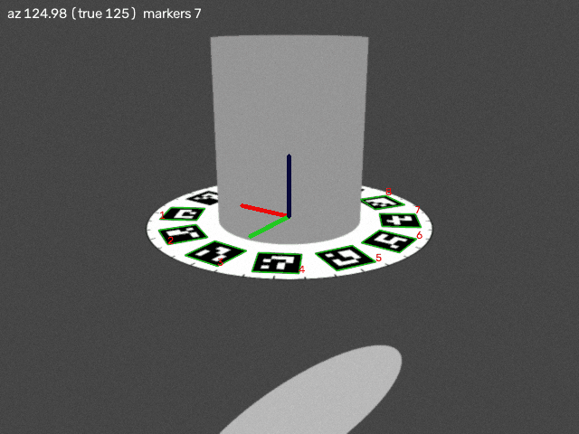
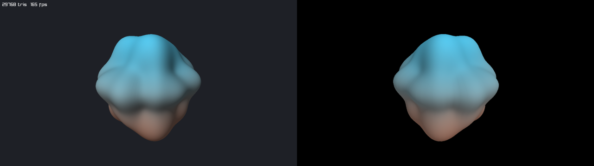

# M0 — Spikes de viabilidad: resultados y pasos pendientes

Estado al abrir el PR de M0. Lo que se puede hacer sin hardware está implementado y probado; lo que necesita el iPhone, la Pi 3 o la maqueta queda como instrucciones paso a paso en este documento. Cada spike termina con una **decisión** que se completa cuando se corra la parte con hardware.

| Spike | Hecho sin hardware | Falta con hardware | Estado |
|---|---|---|---|
| Esqueleto | Estructura del repo, build de Python, renderer y módulo de kernel; pruebas unitarias | Compilar en las tres máquinas | Parcial |
| 0a Record3D | Lector `.r3d`, ingesta USB con `record3d`, volcado a PNG/NPY/PLY, `.r3d` sintético | Streaming real desde el iPhone 12 | Código listo |
| 0b Anillo ArUco | Generador del anillo, estimador de pose, barrido sintético con oclusiones | Anillo impreso y grabación real | Sintético aprobado |
| 0c raylib DRM | Renderer de escritorio con GLB de 8k, modo `hologram`, benchmark, build DRM y GLES2 verificados | ≥30 fps en la Pi 3 | Código listo |
| 0d Reflejo | Modo `hologram` (fondo negro, espejado, autorrotación) | Prueba con monitor y panel | Pendiente |

---

## Preparación común

```bash
# Una vez por máquina (Linux). uv: https://docs.astral.sh/uv/
uv sync                       # numpy, opencv, pillow, pyliblzfse
uv run pytest                 # 46 pruebas, < 2 s
```

---

## 0a — Record3D → RGB-D en Python

**Qué hay**
- `host/capture-service/src/capture_service/r3d_reader.py`: lee un `.r3d` (zip con `metadata`, `rgbd/<i>.jpg`, `rgbd/<i>.depth` comprimido con LZFSE y `rgbd/<i>.conf` opcional). Devuelve `RgbdFrame` con RGB, profundidad en metros e intrínsecas; las de profundidad se escalan desde las del RGB.
- `host/capture-service/src/capture_service/record3d_stream.py`: sesión USB con la librería `record3d` (callback → `Read()` bloqueante).
- `tests/spikes/0a-record3d/`: `inspect-r3d.py`, `stream-record3d.py` y `make-synthetic-r3d.py`.

**Verificado sin teléfono:** ida y vuelta con un `.r3d` sintético (profundidad exacta, `K` en column-major, intrínsecas por frame, errores de formato). El formato se implementó según la documentación pública de Record3D; **todavía no se ha probado con un archivo real**, por eso el primer paso con el teléfono es `inspect-r3d.py`.

### Pasos con el iPhone 12

1. En Record3D, comprar el streaming USB y elegir la cámara **frontal (TrueDepth)**. El iPhone 12 no tiene LiDAR; la librería debe reportar `device type: TrueDepth`.
2. En la PC:
   ```bash
   sudo apt install usbmuxd
   uv sync --extra record3d
   ```
3. Conectar el iPhone por cable, aceptar "Confiar en esta computadora" y activar el modo USB en la app.
4. Probar el streaming:
   ```bash
   uv run tests/spikes/0a-record3d/stream-record3d.py --list
   uv run tests/spikes/0a-record3d/stream-record3d.py --seconds 10 --save-dir out/0a-usb --save-every 60
   ```
   Anotar: fps promedio, resolución de RGB y de profundidad, intrínsecas, rango de profundidad con un objeto a ~30 cm.
5. Abrir un `.ply` de `out/0a-usb/` en MeshLab o CloudCompare: una pared o mesa debe verse plana y el objeto con su tamaño real.
6. **Respaldo `.r3d`:** grabar 10–20 s en la app, exportar como `.r3d`, pasarlo a la PC y correr:
   ```bash
   uv run tests/spikes/0a-record3d/inspect-r3d.py captura.r3d --save-dir out/0a-r3d
   ```
   Si el lector falla, guardar el mensaje de error y la salida de `unzip -l captura.r3d`: con eso se ajusta el parser.

**Gate 0a:** frames RGB-D con intrínsecas en Python. La comprobación cruzada de intrínsecas y unidades se hace en 0b (residuo profundidad-vs-pose).

**Decisión:** _pendiente_ — USB (captura automática) o `.r3d` (selección de vistas posterior).

---

## 0b — Pose con el anillo ArUco

**Qué hay**
- `hardware/aruco-ring/generate-ring.py`: PDF/PNG carta a 300 dpi y `ring-layout.json`. Por defecto: plato de 180 mm, 12 marcadores `DICT_4X4_50` (IDs 0–11) de 24 mm a 70 mm del centro, marcas cada 10° en el borde (la más larga en 0°, sobre el marcador 0) y una barra de 50 mm para verificar la escala de impresión.
- `common/src/astrea_common/aruco_ring.py`: geometría del anillo, compartida por el generador y el estimador, así que no pueden desalinearse.
- `host/capture-service/src/capture_service/ring_pose.py`: detección con `cv2.aruco` y un solo `solvePnP` (SQPnP + refinamiento LM) con las esquinas de todos los marcadores visibles. Descarta un marcador cuyas esquinas no concuerdan con el resto (p. ej. medio tapado por una mano) y vuelve a resolver. Devuelve azimut, elevación, distancia y error de reproyección.
- `host/capture-service/src/capture_service/synthetic_ring.py`: renders sintéticos del plato en poses conocidas (homografía exacta del plano), con un cilindro que tapa los marcadores de atrás, manos aleatorias, desenfoque y ruido. Cámara de 640×480 con fx = 600 px, similar al RGB del TrueDepth.



### Resultado sintético

`uv run tests/spikes/0b-ring-pose/synthetic-sweep.py --out-dir out/0b-sweep` (36 azimuts × 4 elevaciones × 3 distancias de 280–450 mm, objeto de 90 mm de diámetro, una mano aleatoria por vista, ruido σ = 3):

| Métrica | Valor |
|---|---|
| Vistas evaluadas | 432 |
| Vistas con pose | 431 (99.8 %) |
| Marcadores visibles (mín / mediana / máx) | 2 / 6 / 8 |
| Error de azimut, mediana / p95 / máx (°) | 0.052 / 0.568 / 2.206 |
| Error de rotación, mediana / máx (°) | 0.105 / 3.107 |
| Error de traslación, mediana / máx (mm) | 0.29 / 22.59 |
| Jitter de azimut con pose fija, máx std (°) | 0.035 |
| Vistas con error de azimut ≥ 1.0° | 10 |

| Subconjunto | Vistas | Error de azimut p95 / máx (°) | Vistas ≥ 1° |
|---|---|---|---|
| elevación 20° | 108 | 0.271 / 0.656 | 0 |
| elevación 35° | 108 | 0.439 / 0.821 | 0 |
| elevación 50° | 108 | 0.409 / 1.390 | 1 |
| elevación 65° | 107 | 1.383 / 2.206 | 9 |
| ≥ 5 marcadores | 329 | 0.255 / 1.376 | 1 |
| < 5 marcadores | 102 | 1.390 / 2.206 | 9 |

Sin manos (`--hands 0`), las 432 vistas quedan bajo 0.34° de error.

**Lectura**
- Con el objeto tapando el lado de atrás, la pose sale estable con 5–8 marcadores visibles: se cumple la parte sintética del gate.
- Los errores ≥ 1° aparecen casi solo con **elevación alta (65°)** y **menos de 5 marcadores** (una mano tapa la mitad visible del anillo). A 65° el azimut está mal condicionado porque la cámara queda cerca del eje de giro.
- Recomendación para M3: capturar entre 20° y 50° de elevación, exigir ≥ 5 marcadores para aceptar un keyframe y apoyarse en la espera de pose estable de ~0.5 s, que ya descarta los frames con la mano encima.

### Pasos con el anillo real

1. Generar e imprimir:
   ```bash
   uv run hardware/aruco-ring/generate-ring.py --out-dir hardware/aruco-ring/out
   ```
   Imprimir `aruco-ring.pdf` **al 100 %** (sin "ajustar a la página"). Medir la barra: debe dar 50 mm; si no, corregir la escala de la impresora. Pegarlo en cartón rígido y plano, y recortar el disco.
2. Sin tornamesa: poner el cartón sobre una mesa lisa y **girarlo a mano**, o dejarlo fijo y **mover el teléfono alrededor**. Para el estimador es lo mismo, porque mide la posición de la cámara en el marco del plato. Al girar el plato en sentido antihorario (visto desde arriba), el azimut medido **baja**.
3. Teléfono en un soporte a 30–40 cm, mirando hacia abajo con 30–45° de elevación, con un objeto en el centro del plato.
4. Correr el tracking (USB o `.r3d`):
   ```bash
   uv run tests/spikes/0b-ring-pose/track-ring.py --usb --seconds 60 --show --csv out/0b-usb.csv
   uv run tests/spikes/0b-ring-pose/track-ring.py --r3d captura.r3d --csv out/0b-r3d.csv
   ```
   Si nunca detecta marcadores, repetir con `--flip-horizontal` (la imagen de la cámara frontal podría venir espejada).
5. Tres pruebas, cada una con su CSV:
   - **Estática:** 10 s sin mover nada. El resumen imprime la desviación circular del azimut; se espera < 0.2°.
   - **Pasos de 30°:** marcar una referencia fija en la mesa (una línea de lápiz) y alinear con ella las marcas largas del borde, 2 s en cada una, una vuelta completa. Las diferencias entre mesetas consecutivas deben dar 30° ± 1° (adelanta el gate de M3).
   - **Oclusión:** tapar con la mano distintas partes del anillo. Anotar en qué casos se pierde la pose y con cuántos marcadores sigue.
6. Revisar el **residuo profundidad-vs-pose** del resumen (profundidad medida en el centro de cada marcador menos la z que predice la pose ArUco). Si la mediana es de pocos milímetros, las intrínsecas, las unidades y la alineación RGB/profundidad de 0a están bien. Un residuo proporcional a la distancia indica intrínsecas mal escaladas; uno constante indica un desfase de profundidad.

**Gate 0b:** pose estable con parte de los marcadores tapados, en datos reales.

**Decisión:** _pendiente_ — confirmar el anillo de 12 × 24 mm o ajustar el tamaño (`--marker-size-mm`, `--plate-diameter-mm`) según la distancia real de captura.

---

## 0c — raylib en la Pi 3 (preparación)

**Qué hay**
- `renderer/` (C + raylib 5.5, que CMake descarga solo): `renderer --mode viewer|hologram --lod high|low`, carga GLB con colores por vértice, cámara orbital (yaw, pitch, zoom) y sombreado Lambert con luz fija a la cámara. En `hologram`: fondo negro, imagen espejada (`--mirror none|horizontal|vertical`), luz ambiente más alta y autorrotación.
- `--benchmark N`: N segundos sin límite de fps; imprime fps promedio, 1 % low y peor frame. `--screenshot archivo.png` guarda una captura y sale.
- `tests/spikes/0c-renderer/make-test-glb.py`: GLB de prueba con el presupuesto de triángulos (8064 para LOD-low, 30k para LOD-high).
- Verificado en la PC: el build de escritorio, el build `PLATFORM_DRM` (x86) y un build GLES2 de escritorio que compila y ejecuta los mismos shaders GLSL ES 100 que usará la Pi.



En la PC de desarrollo (sin GPU, llvmpipe por software) da ~180 fps a 1280×720 con 8k triángulos; ese número no dice nada de la Pi.

### Pasos en la Pi 3

1. Instalar **Raspberry Pi OS Lite de 64 bits** y comprobar que `/boot/firmware/config.txt` tiene `dtoverlay=vc4-kms-v3d` (viene así por defecto).
2. Dependencias y build:
   ```bash
   sudo apt install build-essential cmake git libdrm-dev libgbm-dev libegl-dev libgles2-mesa-dev
   git clone <repo> && cd pg2-ce4303/renderer
   cmake -B build -DCMAKE_BUILD_TYPE=Release -DRENDERER_PLATFORM=DRM
   cmake --build build -j4
   ```
3. Generar el GLB en la PC (`make-test-glb.py renderer/models/lod-low.glb`) y copiarlo a `renderer/models/` en la Pi con `scp`.
4. Con el monitor conectado por HDMI, **desde la consola o por SSH** (sin escritorio):
   ```bash
   sudo usermod -aG video,render,input $USER   # una vez, luego reiniciar sesión
   ./build/renderer --mode hologram --lod low --benchmark 30
   ./build/renderer --mode hologram --lod low --width 1280 --height 720 --benchmark 30
   ./build/renderer --mode hologram --lod low --mirror none --benchmark 30
   ```
   En DRM el page flip va sincronizado con el monitor, así que el máximo es ~60 fps.
5. Anotar en una tabla: resolución, espejado sí/no, fps promedio, 1 % low, `vcgencmd measure_temp` al final.

**Gate 0c:** ≥ 30 fps con 8k triángulos. Si no llega: bajar a 720p, quitar el espejado por render texture (se puede espejar con la matriz de proyección) o reducir LOD-low, y documentarlo.

**Decisión:** _pendiente_ — resolución y LOD-low definitivos para la Pi.

---

## 0d — Prueba de reflejo

No necesita la Pi: cualquier laptop o PC con el renderer de escritorio sirve para la prueba óptica.

1. Monitor (o la pantalla de una laptop) **boca arriba**, panel de PETG/acrílico/vidrio a **45°** encima, y una caja o cartulina negra mate detrás.
2. Correr en pantalla completa con el monitor que hará de fuente:
   ```bash
   ./build/renderer --mode hologram --lod low --width 0 --height 0
   ```
3. Mirar desde la posición del público y elegir el espejado que deja el modelo **al derecho** (`--mirror horizontal`, `vertical` o `none`, según cómo quede orientado el monitor).
4. Probar con la iluminación prevista para la demo (luz del aula encendida y apagada) y con 2–3 niveles de brillo del monitor.
5. Tomar fotos desde el punto de vista del público: sirven de evidencia para el informe (M7).

**Gate 0d:** el reflejo se ve con la iluminación prevista para la demo.

**Decisión:** _pendiente_ — material del panel, eje de espejado y condiciones de luz.

---

## Esqueleto (gate "compila en las tres máquinas")

En cada máquina (host, worker B, Pi):

```bash
uv sync && uv run pytest
uv run python -m worker            # imprime "skeleton only"
cd renderer && cmake -B build -DCMAKE_BUILD_TYPE=Release && cmake --build build -j
```

Solo en la Pi, además:

```bash
sudo apt install raspberrypi-kernel-headers   # o linux-headers-rpi-v8, según la versión del SO
cd driver/holo-io && make
sudo insmod holo-io.ko && dmesg | tail -2 && sudo rmmod holo-io
```

El módulo esqueleto se compiló en la PC contra headers 6.8 de x86; en la Pi falta probarlo.
